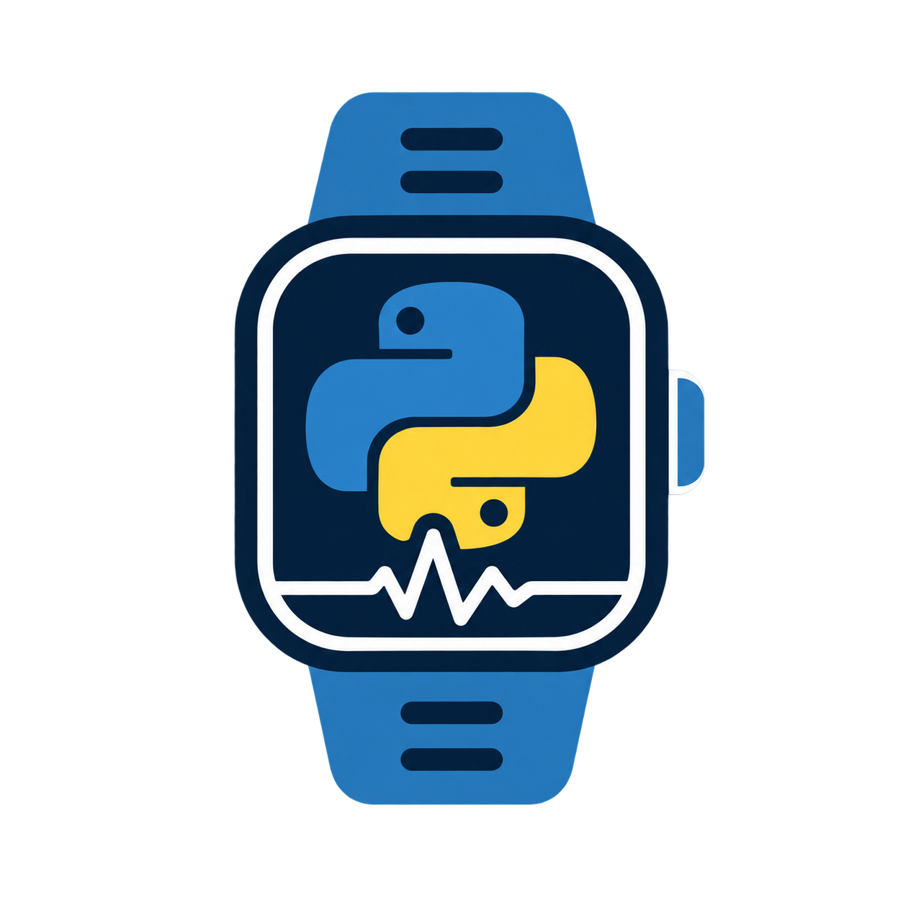
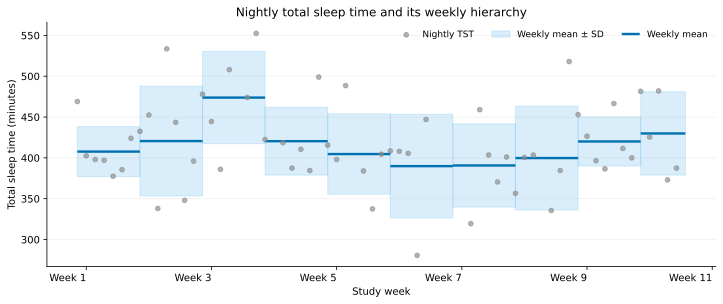
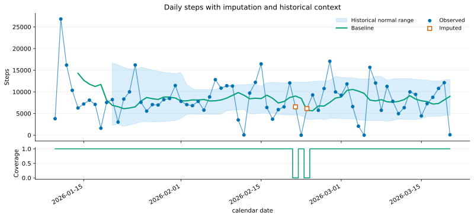
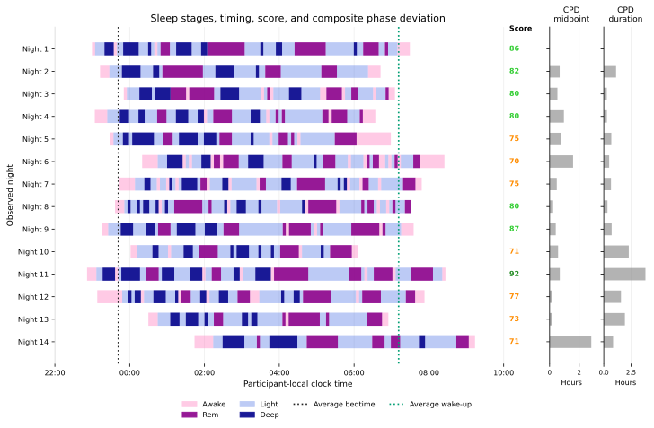

<p align="center">
  
</p>

<h1 align="center">pywearable</h1>

<p align="center"><strong>From wearable exports to analysis-ready longitudinal features.</strong></p>

<p align="center">
  <a href="https://github.com/MeDiTech-SUPSI/pywearable/actions/workflows/python-app.yml"></a>
  <a href="https://github.com/MeDiTech-SUPSI/pywearable/actions/workflows/documentation.yml"></a>
  <a href="LICENSE"></a>
</p>

<p align="center">
  <a href="https://meditech-supsi.github.io/pywearable/">Documentation</a> &middot;
  <a href="https://meditech-supsi.github.io/pywearable/_notebooks/analysis_examples.html">Examples</a> &middot;
  <a href="https://github.com/MeDiTech-SUPSI/pywearable/issues">Report an issue</a>
</p>

**pywearable** is an open-source Python library for loading, harmonizing,
analyzing, and visualizing data from wearable devices. It brings heterogeneous
exports into shared schemas, so the same analysis code can work across
supported sources, with a focus on longitudinal sleep and physiological data.

## Main features

- **One analysis interface across sources.** Load provider exports and public
  research datasets through a common loader contract.
- **Features across health domains.** Extract sleep duration, timing,
  fragmentation, and regularity; heart rate and HRV; activity; respiration and
  oxygen saturation; and provider-native scores.
- **Flexible time scales.** Work with fixed-duration, daily, nightly, weekly,
  monthly, or yearly windows, including sleep-anchored night, awake, and
  physiological cycles.
- **Hierarchical extraction.** Build broader summaries from qualified child
  windows, such as weekly means of nightly sleep duration.
- **Coverage-aware outputs.** Return pandas DataFrames indexed by participant
  and time, with feature values and their supporting coverage in separate
  columns.
- **Longitudinal exploration.** Add explicit imputation, historical baselines,
  and normal ranges; inspect trajectories, hypnograms, coverage heatmaps,
  weekday profiles, and cohort adherence.

## Supported data sources

| Source | Loader | Input |
| --- | --- | --- |
| Labfront | `LabfrontLoader` | Extracted study exports containing Garmin data |
| OURA | `OuraLoader` | Locally saved OURA API v2 JSON responses, organized by participant and endpoint |
| LifeSnaps | `LifeSnapsParquetLoader` | Locally converted Parquet version of the dataset |
| Tesserae | `TesseraeCSVLoader`, `TesseraeParquetLoader` | Published CSV layout or locally converted Parquet files |

See the
[data-source guide](https://meditech-supsi.github.io/pywearable/_pages/data_sources.html)
for supported streams and input layouts.

## Installation

Requires **Python 3.10 or newer**. Install from a local checkout:

```bash
git clone https://github.com/MeDiTech-SUPSI/pywearable.git
cd pywearable
python -m pip install .
```

Optional dependencies can be installed separately:

```bash
python -m pip install ".[parquet]"   # Parquet-based loaders
python -m pip install ".[neurokit]"  # Optional NeuroKit HRV backend
```

## Quick examples

### Extract nightly features and weekly summaries

Choose a loader for your data, then request features through the domain API.
This example uses a local OURA export:

```python
from pywearable import sleep
from pywearable.loader import OuraLoader

loader = OuraLoader("path/to/oura-export")
participant = loader.get_user_ids()[0]

nightly = sleep.get_sleep_statistics(
    loader,
    statistic=["sleep_TST", "sleep_SE"],
    user_id=participant,
    resolution="nightly",
)
print(nightly.head())

weekly = sleep.get_sleep_statistics(
    loader,
    statistic="sleep_TST",
    user_id=participant,
    resolution=("nightly", "weekly"),
    aggregation="mean",
    min_valid_children=(None, 4),
)
```

### Add historical context to a daily trajectory

Using the same loader and participant, extract daily steps, optionally fill
eligible gaps, and plot a historical baseline and normal range:

```python
from pywearable import activity, trajectory, visualization

steps = activity.get_activity_statistics(
    loader, statistic="activity_steps", user_id=participant, resolution="daily"
)
filled = trajectory.impute_trajectory(
    steps, "activity_steps", method="rolling_median", window=7, min_periods=4
)
enriched = trajectory.compute_trajectory_trend(
    filled,
    "activity_steps",
    baseline_window=7,
    min_periods_baseline=4,
    normal_range_window=21,
    min_periods_normal_range=10,
)
visualization.plot_trajectory_trend(
    enriched, "activity_steps", show_coverage=True, ylabel="Steps"
)
```

## Visualizations

### Multiple resolutions, one view

Nightly total sleep time alongside weekly means and standard-deviation bands.



### Trajectories with trend and coverage

Observed and imputed daily steps, a historical baseline, a normal range, and
the source coverage behind each day.



### Longitudinal hypnograms

Sleep stages across nights, with sleep scores, average sleep timing, and
composite phase deviation (CPD) panels.



See the [visualization guide](https://meditech-supsi.github.io/pywearable/_pages/visualization.html)
for more plots and customization options. Plotting functions return Matplotlib
axes for further editing.

## Contributing

New loaders, features, bug reports, and documentation improvements are welcome.
Open an [issue](https://github.com/MeDiTech-SUPSI/pywearable/issues) to discuss
your use case or a [pull request](https://github.com/MeDiTech-SUPSI/pywearable/pulls)
with focused changes and tests. For loader development, see the
[custom-loader tutorial](https://meditech-supsi.github.io/pywearable/_notebooks/custom_loader.html).

Developed at the MeDiTech Institute, SUPSI, with contributions from the
[project contributors](https://github.com/MeDiTech-SUPSI/pywearable/graphs/contributors).
For questions, contact [Davide Marzorati](mailto:davide.marzorati@supsi.ch)
or [Alvise Dei Rossi](mailto:alvise.deirossi@supsi.ch).

## License

pywearable is distributed under the [MIT license](LICENSE). Source datasets
remain subject to their own access conditions, licenses, and citation requirements.

## Citation

A manuscript describing pywearable is currently under submission for
peer-reviewed publication. This section will be updated once the article is
published. In the meantime, if you use pywearable in your work, please cite
[this repository](https://github.com/MeDiTech-SUPSI/pywearable).

